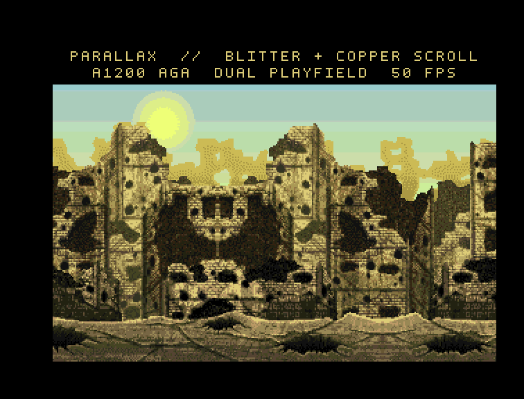

# Parallax Scrolling Demo — Amiga 1200 (AGA)

A three-layer parallax demo for AGA Amigas, drawn **entirely with the blitter**,
using the war-torn background art from
`craftpix-771800-free-war-pixel-art-2d-game-backgrounds.zip`
(the **War1 / Bright** layer set: sky, sun, ruins, houses, road, fence, craters).



## What you see

* **352×256 AGA PAL screen, 5 bitplanes (32 colours)** with a 320×200 visible
  window at (16, 28); the remaining area is a black border used for the title
  (`PARALLAX // BLITTER SCROLLING`) and caption (`AMIGA 1200 AGA 32 COLOURS`).
* A static **sky + sun** background.
* A **midground** of ruins/buildings, scrolled with the blitter at
  **0.375 px per 50 Hz tick** (≈18.75 px/s), rendered as an *opaque* band (the
  sky above the silhouette is prefilled with the row's sky colour, holes are
  black).
* A **foreground** of houses/road/fence/craters, scrolled at **1 px per tick**
  (≈50 px/s), rendered with a **cookie-cut masked blit** so the midground
  shows through.
* **Time-based scrolling**: offsets advance by the elapsed 50 Hz ticks
  (`DateStamp`), so the speed stays constant even when a frame takes longer.
* Double buffering with `graphics.library/ChangeVPBitMap()` (V39+); the loop
  flips on the vertical blank and drains the DBufInfo notifications.

## Controls

* **ESC** or **CTRL-C** — quit and return to Workbench.

## Build

From the repository root:

```sh
make adf       # build build/parallax-demo.adf (default target)
make hdf       # build build/parallax-demo.hdf
```

`make` extracts the supplied zip into `assets/` (once), regenerates the planar
assets and `src/assets.h`, cross-compiles the demo in the
`amigadev/crosstools:m68k-amigaos` Docker image, and creates the bootable image
with amitools.

Requirements: Docker, `python3` + Pillow, `unzip`, and amitools
(`xdftool`/`rdbtool`). If amitools is installed in a virtualenv:

```sh
make adf AMITOOLS_PY=/path/to/python-with-amitools
```

The direct cross-compile is still available:

```sh
docker run --rm -v "$PWD/src:/work" -w /work \
    amigadev/crosstools:m68k-amigaos make
```

This produces `src/parallax` (an AmigaOS `-noixemul` executable).

## Assets

The PNG layers were extracted from the supplied zip into `assets/`.
[`tools/build_assets.py`](tools/build_assets.py) performs the conversion:

1. Loads `assets/PNG/War1/Bright/*.png` and scales the layers to 320×200.
2. Builds a **32-colour, 12-bit (Amiga 0xRGB)** palette from the full composite
   and remaps the layers with Floyd–Steinberg dithering.
3. Splits the scene into an **opaque midground** (ruins + house3 + houses2,
   with sky/black prefill) and a **masked foreground** (houses1 + fence + road +
   craters, split into a masked top and an opaque bottom).
4. **Mirror-tiles** each layer (`[scene][mirror(scene)]`, period 640 px) and
   appends a 352-px run-out, so horizontal wrapping is seamless.
5. Packs everything into 5 planar planes plus a 1-bit mask plane and writes:
   * `parallax.dat` — background planes + layer strips + masks (215,200 bytes)
   * `palette.bin` — the palette as 32 × 0x0RGB words (reference export)
   * `src/assets.h` — generated offsets, sizes and the palette array

Regenerate with:

```sh
python3 tools/build_assets.py <output-dir>
```

or simply:

```sh
make assets
```

which also extracts the supplied zip into `assets/` if it is missing.

The build outputs live in `build/` (ignored by git):
`parallax`, `parallax.dat`, `palette.bin`, `parallax-demo.adf` (880 KB
bootable floppy) and `parallax-demo.hdf` (16 MB bootable RDB hard-disk image).
The documentation screenshot is [`docs/screenshot.png`](docs/screenshot.png).

## Run on the target

Copy `parallax` and `parallax.dat` to `Work:parallax/` on the Amiga
(the DevBench host share is mounted at `/tmp/opencode/amiga_hd`), then start
`Work:parallax/parallax` from the AmigaBridge launch command or the boot
startup. The program needs the data file at
`Work:parallax/data/parallax.dat`; the palette is compiled into the executable.
If the absolute path is unavailable, the loader also tries
`parallax/data/parallax.dat` and `data/parallax.dat`, and it suppresses
AmigaDOS "insert volume" requesters, so the executable can be run from any
directory that contains the data tree.

## Bootable images

Two ready-to-boot images are built by `make adf` / `make hdf`:

* **`parallax-demo.adf`** — 880 KB bootable FFS floppy (volume `Work`).
  Attach as `DF0:` with an Amiga 1200 Kickstart 3.1 ROM and boot.
* **`parallax-demo.hdf`** — 16 MB hard-disk image with an RDB and one
  bootable 13.9 MB FFS partition (volume `Work`). Attach as a hard disk, e.g.
  Amiberry `-W DH0:build/parallax-demo.hdf`, or the WinUAE/FS-UAE hardfile
  option, with the same ROM and boot.

Both images boot `S/startup-sequence`, which does:

```
CD Work:
parallax/parallax >NIL:
```

The demo starts automatically; ESC or CTRL-C returns to the OS. The images
were boot-tested with Amiberry using a Kickstart 3.1 A1200 ROM.

## Blitter implementation notes

* **Screen layout.** The screen is 352 px wide so a 16-px side border is
  available for a one-word *run-up* on each side. The visible 320-px window
  starts at x = 16.
* **1-pixel scrolling.** Each layer strip is addressed a word at a time. For a
  scroll offset `p`, the source pointer is `p >> 4` words and the blitter's
  **A-channel barrel shifter** (`BLTCON0/ASH = p & 15`) aligns the pixels.
  Because the blitter shifts in the previous word, one extra word is blitted
  at x = 0..15 (hidden in the border); the visible window at x = 16 then starts
  exactly at source pixel `p`. For `ASH = 0` the source pointer is moved one
  word back so the run-up word is still present.
* **Planes.** The blitter has one destination channel, so each layer band is
  copied one plane at a time (5 blits), with `BLTxMOD` set to
  `strip_stride - 352/8`. All source/mask data lives in chip RAM.
* **Opaque bands** use minterm `0xF0` (A→D, 2 cycles/word) with only A and D
  enabled.
* **Masked foreground** uses the cookie-cut minterm `0xE2`
  (`D = (A & B) | (C & ~B)`) with A = source plane, B = mask plane and
  C = D = screen (4 cycles/word).
* **Mid-layer skip.** The midground's integer offset only changes every few
  frames, so it is redrawn only when the offset for the target buffer changed;
  the foreground is redrawn every frame.
* **Double buffering.** Two displayable bitmaps are swapped with
  `ChangeVPBitMap()` at the vertical blank. The back buffer is the previous
  front, so it is already safe to write; DBufInfo notifications are drained
  rather than waited on, avoiding frame-pacing stalls.
* **Time-based motion.** The blitter still moves whole pixels, but the scroll
  offset is advanced from the 50 Hz `DateStamp` tick counter. On a slow frame
  the layers move 2–3 px instead of 1 px, keeping pixels/second constant.
* **Blitter priority** (`DMACON/BLTPRI`) is enabled, and the demo runs at
  task priority −10 so the serial/TCP development bridge stays responsive
  while the demo is composing frames.

## Performance

On the emulated A1200 (68020, 2 MB chip) the demo runs at roughly
**25–26 fps** at 320×200 with 32 colours. The blitter work is dominated by the
opaque midground band (173 rows) and the masked foreground band (45 rows).
Because the scrolling is time-based, the motion speed is constant even when a
frame occasionally takes an extra vertical blank.
The two layers move at different rates, so the parallax is visible even at
this frame rate.

## Limitations / notes

* The source art is a single 1920×1080 scene; the layers are **mirror-tiled**
  (period 640 px, i.e. two screen widths) to obtain seamless horizontal
  wrapping.
* 32 colours with dithering; the original art has thousands of colours.
* Target is AGA (A1200). The code uses `AllocBitMap`/`ChangeVPBitMap`/V39
  graphics, `DMACON/BLTPRI` and a 352×256×5 screen.
